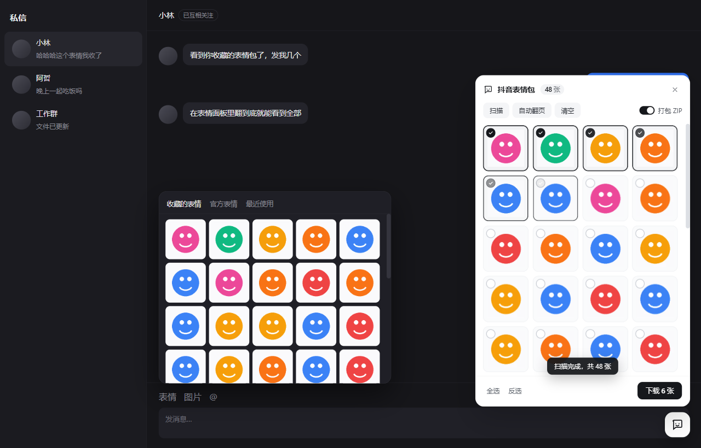

# 抖音表情包下载器（Chrome MV3 扩展）

在抖音网页版扫描**已加载**的表情包，用浮层勾选后批量打包下载。纯本地运行，不上传任何数据。



## 功能

- 扫描当前页面已加载的表情图：评论区表情、私信表情、收藏的表情
- 自动翻页：找到表情面板的滚动容器，从头滚到底，边滚边收集懒加载内容
- 浮层勾选：网格预览、单选、全选、反选、清空
- 批量下载：默认打包为 ZIP，也可关闭开关逐张下载
- 自动去重：按去掉 `x-signature` / `x-expires` 后的图片路径去重
- 保留原图格式（WebP / GIF / PNG），文件名带序号和表情名
- 支持表情面板位于 iframe 中的情况
- 浮动按钮可拖动，位置会记住

## 安装

1. 打开 `chrome://extensions/`
2. 打开右上角「开发者模式」
3. 点击「加载已解压的扩展程序」，选择**包含 `manifest.json` 的这一层目录**

> 不要选择它的父目录，也不要选择里面的某个单独文件。

## 使用

1. 打开 [抖音网页版](https://www.douyin.com/) 并登录
2. 进入「消息」→ 任意私信 → 点输入框旁的表情按钮 → 切到 **收藏的表情**
3. 点击页面右下角的白色气泡按钮打开浮层
4. 点击「自动翻页」，等待提示扫描完成
5. 勾选需要的表情，点击「下载 N 张」

也可以只打开评论区、让表情出现在当前页面，再点「扫描」。

## 为什么不用普通下载器

抖音表情图的地址类似：

```
https://p3-im-emoticon-sign.byteimg.com/....webp?x-expires=...&x-signature=...
```

`x-signature` 是与登录会话绑定的临时签名，脱离浏览器直接请求会返回 403。因此本扩展在**页面上下文内**用 `fetch()` 取图（自动携带 Cookie 和 Referer），在浏览器本地用 JSZip 打包后保存；只有当整批请求都被拦截时，才回退到 `chrome.downloads`。

表情列表本身通过 URL 特征识别（`emoticon` / `emotion` / `sticker` / `emoji` / `expression`，并排除头像），不依赖抖音前端随时会变化的 class 名。

## 说明

- 动图保存为抖音原始 WebP 格式，没有转换成 GIF；微信不支持动态 WebP，如需要 GIF 请自行转换
- 只能获取**当前页面已经加载出来**的表情，因此需要先展开面板并滚动加载
- 仅供个人备份自己收藏的表情使用，请勿批量抓取或传播他人作品
- 与抖音官方无关，使用产生的一切后果由使用者自行承担

## 许可证

MIT © 2026 SamBUFF

依赖的 JSZip 3.10.1 使用 MIT 许可证，版权归其原作者所有。
